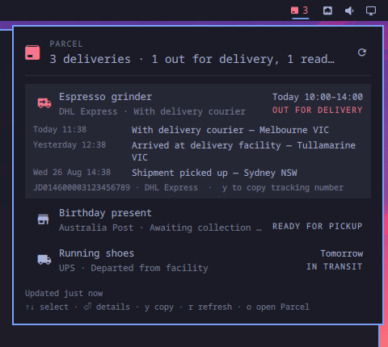

# Parcel for Omarchy

> **Fork.** This is Ricardo Liberato's fork of
> [zuccs/omarchy-parcel-app](https://github.com/zuccs/omarchy-parcel-app), under
> its own plugin id `riclib.parcel`. It carries the panel-dismissal fix from
> upstream PR #2: on Omarchy 4.0.x `bar.centerHoverRevealSuppressed` is
> read-only, so upstream's `close()` threw before hiding and the panel could
> never be closed (upstream issue #1).

Your [Parcel](https://parcelapp.net) deliveries in the Omarchy bar.



A bar badge shows how many parcels are on the way and lights up when one is
out for delivery (or needs attention). Click it for a panel listing every
active shipment with carrier, latest checkpoint and ETA; expand a row for the
full timeline. When a parcel changes state you get a desktop notification.

Parcel is the iOS/macOS tracking app most of us already have on our phone.
This plugin doesn't replace it — it reads the deliveries you've already added
there through Parcel's Premium API, so your desktop and your phone agree.

> **Requires** Omarchy Quattro (`omarchy-shell`) and a [Parcel Premium](https://parcelapp.net/help/premium.html)
> subscription — the API is a Premium feature. External dependencies are all
> part of a stock Omarchy install: `curl`, `jq`, `secret-tool` (libsecret),
> `wl-copy` (wl-clipboard) and `flock` (util-linux). No sudo, no packages to
> install, no changes to your configuration beyond the plugin's own entry in
> `shell.json` that `omarchy plugin enable` writes.

## Install

```bash
omarchy plugin add https://github.com/riclib/omarchy-parcel-app.git --enable
```

The widget lands in the right section of the bar. Move it with `omarchy bar move`.

## Setup

1. Sign in at [web.parcelapp.net](https://web.parcelapp.net) and generate an API key
   (Settings → API).
2. Store it in your login keyring. `secret-tool` prompts for the value so it never
   touches your shell history:

   ```bash
   secret-tool store --label='Parcel API key' service omarchy-parcel key api-key
   ```

3. Press `r` in the panel (or middle-click the badge). Until a key is stored the
   panel shows these same instructions with a copy button.

Verify from a terminal any time:

```bash
~/.config/omarchy/plugins/riclib.parcel/bin/parcel-api status
~/.config/omarchy/plugins/riclib.parcel/bin/parcel-api deliveries active | jq
```

## Using it

| Where | Action |
|---|---|
| Badge — left click | Open / close the panel |
| Badge — middle click | Refresh now |
| Badge — right click | Open web.parcelapp.net |
| Panel — `↑` `↓` / `j` `k` | Move between deliveries |
| Panel — `Enter` / `Space` / click | Expand the checkpoint timeline |
| Panel — `y` or `c` | Copy the tracking number |
| Panel — `r` | Refresh now |
| Panel — `o` | Open web.parcelapp.net |
| Panel — `Tab` / `Shift+Tab` | Switch to the neighbouring bar panel |
| Panel — `Esc` | Close |

Bind a key in `~/.config/hypr/bindings.lua`:

```lua
o.bind("SUPER + CTRL + SHIFT + P", "Parcel", "omarchy-shell shell toggle riclib.parcel")
```

## Command line

`bin/parcel` is the same data from a terminal, for you or for an agent that
reads your mail: a readable list by default, one JSON object with `--json`.

```bash
ln -s ~/.config/omarchy/plugins/riclib.parcel/bin/parcel ~/.local/bin/parcel

parcel list [--recent] [--fresh] [--json]   # most urgent first
parcel show <tracking|text> [--json]        # one delivery's event timeline
parcel carriers dhl                         # carrier codes by name
parcel add <tracking> <carrier> "<description>" [--email E] [--postcode P] [--language xx] [--no-push]
```

Reads go through `bin/parcel-api` with a 5-minute cache, so the CLI and the
widget share one cache and Parcel's 20 requests/hour; `--fresh` skips the
cache. `add` calls the API itself, because it can send the email, postcode
and language some carriers need, and it refuses an unknown carrier code (or a
carrier that needs an email or postcode it was not given) before spending one
of the 20 adds a day, which failed adds also use up.

It uses the same keyring entry as the widget. If you would rather keep the key
in a file, put `PARCEL_API_KEY=...` in `~/.config/secrets/parcel.env` (or point
`PARCEL_ENV_FILE` elsewhere): the file then wins, and each run copies it into
the keyring when they differ, so the widget follows. `parcel sync-key` does
only that.

## Uninstall

```bash
omarchy plugin remove riclib.parcel
```

That removes the plugin directory and its `shell.json` entry. Two things are
yours and are left alone; clear them if you want a clean slate:

```bash
secret-tool clear service omarchy-parcel key api-key   # the API key in your keyring
rm -rf ~/.local/state/omarchy/parcel                    # cached deliveries
```

If you added a keybind in `~/.config/hypr/bindings.lua`, delete that line too.

## Settings

Settings live inline on the widget's entry in `~/.config/omarchy/shell.json`,
like every Omarchy bar widget. The defaults:

```json
{ "id": "riclib.parcel", "refreshIntervalSec": 600, "filterMode": "active", "notifications": "On", "hideWhenEmpty": "Off" }
```

| Key | Values | Meaning |
|---|---|---|
| `refreshIntervalSec` | `300`–`3600` | How often to poll. Floor is 300 s: Parcel allows 20 requests/hour and manual refreshes count. |
| `filterMode` | `active` / `recent` | `active` shows parcels in progress; `recent` also includes recently delivered ones. |
| `notifications` | `On` / `Off` | Desktop notification when a parcel changes state (e.g. goes out for delivery, or is delivered). |
| `hideWhenEmpty` | `On` / `Off` | Hide the badge entirely when nothing is on the way. |

## How it behaves

- **Rate limits.** The last good response is cached in
  `~/.local/state/omarchy/parcel/` (mode `0600`). Opening the panel or restarting
  the shell reads the cache; only the timer and explicit refreshes hit the API.
  If Parcel returns 429 or the network is down, the cached data stays on screen
  with an "Offline — showing data from …" note.
- **Several monitors, one request.** Each monitor's bar hosts its own copy of the
  widget; the bridge serialises them with `flock`, so they share one fetch and
  one set of notifications.
- **Notifications** compare consecutive fetches: a parcel changing status is
  reported; a parcel that drops out of the list is reported as *no longer active*
  (Parcel's feed doesn't say whether it was delivered or removed — use
  `filterMode: "recent"` if you want explicit *Delivered* transitions); a parcel
  seen for the first time is not reported (your phone already told you).
- **Theme-native.** Colours, fonts, spacing and corner radius come from the
  shell's theme tokens, so it matches whatever Omarchy theme you switch to.

## Privacy & security

- The only network endpoint is `https://api.parcel.app`. The only file written
  is the response cache above.
- Your API key lives in the login keyring (libsecret). It is never written to
  `shell.json`, the QML never reads it, and `bin/parcel-api` hands it to `curl`
  as a config on stdin (`-K -`) rather than as an argument, so it doesn't show
  up in the process list either. `bin/parcel` does the same for `add`, and
  strips control characters from every remote string before printing it, so
  a delivery description cannot drive your terminal.
- Everything the API returns is treated as untrusted — it is relayed from
  carrier systems, not written by Parcel. Response bodies are capped at 1 MiB
  before anything parses them, delivery and event lists are capped before they
  reach the panel, and every remote string is flattened to one bounded line of
  plain text. Every `Text` in the panel is pinned to `Text.PlainText`, so no
  delivery description can turn into rich text and pull in a remote image.
- The state directory sits at a predictable path, so the bridge treats it as
  hostile: it refuses to use it if `omarchy/` or `parcel/` is a symlink, takes
  its cross-monitor lock on the directory itself (there is no lock file to
  plant), writes caches only via `rename(2)`, and reads them with a size cap
  and a timeout so a swapped-in FIFO or oversized file can't wedge the shell.
  A same-user process that races a cache swap between check and read can still
  make the bridge read a file — bounded, and a file that process could already
  read itself.
- `bin/parcel-api` is ~425 lines of bash. Read it before you enable the plugin,
  as with any Omarchy plugin.

## Development

```bash
# Install the normal way — the result is a plain git checkout you can edit in place.
omarchy plugin add https://github.com/riclib/omarchy-parcel-app.git --enable
cd ~/.config/omarchy/plugins/riclib.parcel

omarchy plugin validate .
qmllint -I "$OMARCHY_PATH/shell" *.qml   # note: qmllint 1.0 rejects `function x(): void`, as it does on first-party Weather
node --test test/*.test.js           # Model.js is plain JS and unit-tested
PARCEL_API_KEY=… bin/parcel-api deliveries active --max-age 0 | jq   # bridge without a keyring
```

Saving files under `~/.config/omarchy/plugins/` hot-reloads most plugin kinds,
but bar-widget QML is currently cached until the shell restarts
([basecamp/omarchy#8555](https://github.com/basecamp/omarchy/issues/8555)) —
run `omarchy-restart-shell` after editing `BarWidget.qml` or `Panel.qml`.

Layout:

```
manifest.json     plugin identity, settings schema and defaults
BarWidget.qml     bar entry point: badge + Loader for the panel
Panel.qml         popup: fetch lifecycle, notifications, keyboard list
Model.js          pure functions (parsing, sorting, ETA/relative time, diffs)
bin/parcel-api    the widget's bridge to the network and the API key
bin/parcel        the command-line client; reads through parcel-api, adds on its own
data/carriers.json  bundled carrier code → name snapshot; `bin/parcel-api carriers --refresh`
                  caches a newer list in ~/.local/state/omarchy/parcel/, which the widget
                  prefers on its next shell start
test/             node:test suite for Model.js
```

## Roadmap

- Add a delivery from the panel: paste a tracking number, pick the carrier, done
  (`bin/parcel-api add` already exists — Parcel allows 20 adds/day).
- Optional Parcel-style route map for the expanded row.

## License

MIT — see [LICENSE](LICENSE). Not affiliated with Parcel or Omarchy.
